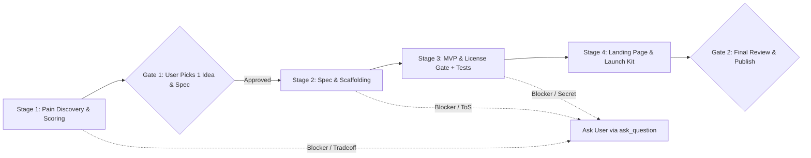

# Friction-Killer Software & Plugin Factory

An automated, token-efficient workspace for discovering high-friction software pain points, scoring commercial viability, building lean MVPs with zero-backend license monetization (**Polar.sh**, **Lemon Squeezy**, **Gumroad**), and preparing launch & distribution kits.

## Workflow: Lean Gatekeeper Pipeline

## Quick-Start Prompts

Copy and paste any of these when you are ready to start:

- **Agnostic discovery (recommended):**
  > `Run Stage 1: Mine software friction signals across high-ROI niches, score candidates, and pitch the top 3 for Gate 1.`
- **Targeted niche discovery:**
  > `Run Stage 1 targeting Notion, Linear, and VS Code. Score the top opportunities and stop at Gate 1.`
- **Check current pipeline state:**
  > `Check pipeline status and continue from the current stage.`

## Repository Structure

- `AGENTS.md` — Ultra-compact workspace rules & token-efficiency guardrails.
- `.agents/skills/` — On-demand stage skills (`stage-1-pain-discovery` through `stage-4-launch-and-monetize`) loaded only for the active stage.
- `scripts/` — Zero-dependency Python 3 CLI helpers that keep raw data out of the LLM context:
  - `pipeline_ctl.py` — Inspect and update `pipeline/state.json`.
  - `mine_signals.py` — Harvest compact, deduplicated pain signals from Hacker News, GitHub Issues, and Reddit.
  - `score_opportunity.py` — Compute Effectiveness, Commercial Potential, Composite Score (0–100), and automatic kill-switch verdicts.
  - `scaffold_project.py` — Generate `projects/<slug>/` with starter code, tests, license client, landing page, and launch kit.
- `templates/` — Reusable zero-backend license validators (`license_client.js`, `license_client.py`), Tailwind landing page, spec template, and launch kit template.
- `pipeline/state.json` — Deterministic pipeline state and scored opportunity backlog.
- `projects/` — Generated products (`src/`, `tests/`, `launch/`, `SPEC.md`).

## How Token Usage Is Minimized

1. **Progressive skill loading**: Only the active stage's `SKILL.md` is read into context; root `AGENTS.md` stays compact.
2. **Pre-filtered Python miners**: `scripts/mine_signals.py` strips HTML, deduplicates URLs, and truncates snippets to 250 chars before anything reaches the model.
3. **Deterministic state & scoring**: State tracking and weighted scoring run in Python scripts instead of repeating long histories in chat.
4. **Targeted subagents**: Heavy UI checks or isolated research can be delegated to `flash`-tier subagents.
